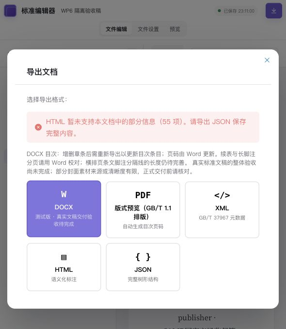

# WP6 验收记录

状态：按调整后 WP6 方案实施，内部数据契约回归与最新复审修复记录见下文；待 PR 审阅及合并。2026-10-06 已重新对照 main，完整完成范围与限制见 [方案审计](wp6-plan-audit.md)。按用户确认的调整方案实施。基线为 `origin/main` 的 `e4690a320233b23122df0ba9a510b30ced16fbe2`；开发分支 `codex/wp6-json-model`。本记录不表示 GB/T 46687.2—2026 XML、外部互操作或 Word 真实稿件验收完成。

## 交付契约

- `renderSemanticJson(PMJsonNode, labels, options?)` 保持现有 PM JSON 导出形状；client 只准备 Resolver 输入及调用渲染器。旧文档缺编号节点 ID 时使用导出临时 ID 与 child-index path 回填标签，不修改原文档。
- `renderJson(IRDoc, labels)` 通过 `irToPm` 输出原生 IR 的语义 JSON；不能表示的内容抛出带位置的 `IRToPmError`。
- `irToPm` 默认生产编辑器 `doc` 根；`standardDoc` 仅为显式选项。数据模型、生产 Schema 和优先级见 [模型契约](wp6-model-contract.md)。
- 基础 IR 保持 `schemaVersion: 1`。新增语义使用 `extensionVersion: 1`；未知版本产生错误诊断。旧文档无新增语义时不强加新版标签。
- 普通保存、版本、复制继续存 PM JSON。旧 XML 存量与调用边界见 [存储及旧 XML 盘点](wp6-storage-xml-inventory.md)。旧 XML 实现只存续至 WP8，不新建 XML37967 渲染器或兼容迁移器。

## 兼容与输出边界

JSON byte golden 固定为迁移前生产 Schema 下的 `sample-standard.xml` 和 `all-elements` fullFixture；文件、基线和 SHA-256 见 `packages/client/src/serializer/__fixtures__/golden/manifest.json`。黄金文件测试只读。

三个旧计数器边界行为改为 Resolver 的统一规则：章下直接二级条 `1.0.1 → 1.1`（同时报告跳级），第 3 章首个二级术语 `3.0.1 → 3.1`，第 27 个附录 `[ → AA`。不声称所有异常输入都保持旧字节输出。

现有 DOCX、HTML（含 PDF 打印 HTML）和旧 XML 没有实现新增结构化信息的完整排版/交换。因此，对非空新字段、新角色和无法映射的正文，出口返回 `unsupported-output`，包含字段路径、关联节点和原因；JSON 保留完整内容。错误不是成功导出，不能据此宣称新信息已经完成打印或 XML 交付。既有 DocumentMeta 标量设置继续沿用原来的版面契约；提出/归口/起草单位的保存保真，不代表本次新增了这些字段的自动正文排版。

嵌套表格明确拒绝。无内容的 Tiptap 自动尾段可跳过；非空根段落没有 IR 正文位置时明确诊断。历史 blockquote、codeBlock 与嵌套 termDef 改为保留类型/结构，不能继续通过旧降级方式假装没有信息损失。脚注的既有格式与位置限制继续生效。

## 验收项目

| 项目 | 证据 | 结果 |
|---|---|---|
| 旧 JSON 两组 byte golden / 缺 ID / 原型键安全 / Resolver 边界编号 | client `jsonExporter.test.ts`、shared `renderers/json.test.ts` | 通过 |
| 新元数据、TBX、公式、表图资源、样式、文献、索引的生产 Schema | `createWp6Fixture()`、production schema tests | 通过 |
| 新建原生 IR → PM → Schema → IR | shared/client WP6 model tests | 通过 |
| 逐记录核对生产属性、非文本公式 marks、代码及文献链接显示文本 | `wp6Projection.test.ts` | 通过 |
| 重复/缺失 ID、typed refs、资源/索引引用、外部 ID 定义和引用同改 | shared Resolver / external ID tests | 通过 |
| 实际 SQLite 保存、编辑、版本、副本、服务端重启后重开 | `wp6Persistence.acceptance.test.ts`（显式隔离 API） | 通过 |
| 浏览器编辑保存、刷新、语义 JSON 原文核对及未支持出口报错 | 隔离本地实例 | 通过 |
| 旧 shared/client/server 回归和构建 | pnpm tests/build | 通过 |

API 验收仅在显式指定的空本地数据库和非默认服务端端口运行；默认测试不访问用户数据库。prepare 和 reopen 分开执行，reopen 之前必须实际停止、重启隔离服务端。不能以单次 JSON stringify 代替冷重开证据。

## 最终验证证据

- shared：42 个测试文件、893 项通过；`tsc --noEmit` 通过。
- client：33 个测试文件、211 项通过；隔离 API 验收默认跳过 1 项，另行显式运行。`vue-tsc -b` 与 Vite 构建通过，仅保留现有大包体提示。
- server：2 个 Jest suite、23 项通过；Nest 构建通过。未新增依赖或修改 lockfile。
- 两组 JSON golden 及其迁移前源文件 SHA-256 固定，未更新黄金文件来掩盖回归。兼容差异见上述编号边界记录。

实际 API/SQLite 验收采用独立临时工作目录 `tmp-e2e/wp6-storage`、服务端端口 3096；Vite 5196 只代理到该实例。prepare 完成保存/编辑、JSON 版本快照和副本；停止原进程后实际重启服务，再执行 reopen，原稿、副本和版本逐字段相等。主工作区业务数据库全程只读。

浏览器随后修改验收稿并保存、刷新，发现并修复实际加载入口丢根属性的问题。最后保存稿带 `extensionVersion: 1`、根级回退数据与“根属性已保留/浏览器验收”标记；再次停止并重启隔离服务（原 PID 51141 → 新 PID 63963），重开编辑器。页面实际语义 JSON 经生产 Schema 还原后与 API 保存稿全字段相等，PM→IR 的元数据、TBX、表图、公式、文献、索引等完整相等，术语编号为 `1.1.1`。先以源码面板的实际导出原文核对，再在新浏览器标签执行首次 JSON 下载。下载文件 `/Users/funtasy/Downloads/WP6 隔离验收稿.json` 与面板原文逐字段相同，并再次执行 browser 验收。浏览器工具不回传重复 Blob 下载事件，验收以实际下载文件读取为准。

最终浏览器语义 JSON（仅夹具）SHA-256：`7d120b92e344af68cea77d9cf10f9b408da55c1e57961b048482d67ef9a50e81`。开发机器的原始日志保存在 `/private/tmp/wp6-*.log`，不作为仓库运行依赖。

可复用验收入口为 `extensions/wp6Persistence.acceptance.test.ts`：显式提供 `WP6_API_URL`、`WP6_EVIDENCE_FILE`，分 `prepare`（默认）、`reopen`、`browser` 运行；browser 另提供 `WP6_BROWSER_EXPORT_FILE`。prepare 强制空数据库、回环主机和非默认服务端端口。不得对用户业务数据库执行 prepare。

| 命令 | 结果 |
|---|---|
| shared `pnpm test` / `pnpm exec tsc --noEmit` | 通过 |
| client `pnpm exec vitest run --maxWorkers=2` / `pnpm build` | 通过 |
| server `pnpm exec jest --runInBand` / `pnpm build` | 通过 |
| opt-in API prepare → 真实服务重启 → reopen | 通过 |
| 浏览器编辑保存 → 真实服务重启 → browser 原文全字段核对 | 通过 |

新增语义被未支持出口拒绝时，导出面板保持打开并提示保留 JSON；源码转换失败时复制和下载按钮禁用，不能把诊断文字下载成成功 XML。源码禁用通过生产组件回归，出口面板通过实际浏览器验证。截图仅含测试夹具：

主工作区现有素材修改和未跟踪目录均保留；主素材文件 SHA-256 保持 `8134494f8e129a1880f44725c7f61bda39833149bbb30451e07834f2657809c8`。该基线为 2026-10-05 初始验收状态；2026-10-06 main 已为 e0e9ab09（调整方案 PR #46 合入），开发分支已合入该 main，最新审计以此为准。

## 后续边界

WP8 负责原文元素/属性矩阵、正式 ID 约定、唯一 XML46687.2 双向转换、校验及真实外部互操作。当前描述符 kind/value 与外部 ID 映射是项目数据契约，不是具体 TBX/XML 标准元素认证。新增 MathML 保存原文和编辑源；本次不保证编辑器已把所有原生 MathML 排成数学视觉效果。

## Codex review 修复验收（2026-10-06）

PR #45 在 `9ad90668` 和 `df27182a` 上的两轮 review 共提出 7 条 P2 问题。本次逐条修复：

| Review 问题 | 处理与回归证据 |
|---|---|
| 脚注 crossRef 的 canonical targetId 被误判缺目标 | 与普通引用统一使用 targetId ?? refId；生产 Schema 往返后 Resolver 无 invalid-footnote |
| 简单列项丢段落稳定 ID | 无法保留的原生 IR 段落 ID 通过 IRToPmError 拒绝；五种受支持列表的派生段落 ID 及对应引用往返有效 |
| 显式章角色被标题推断覆盖 | 生产 chapter.secType 持久化并优先读取；四种角色均覆盖非标准标题或与标题相反的角色 |
| 罗马列项被静默降级 | roman/romanUpper 均返回带位置诊断，不改为 numeric |
| 公式 numbered:false 被 Schema 丢弃 | 新增 nullable 生产属性，显式 false 保留；后续 Resolver 标签保持；旧文档默认编号及 JSON byte golden 不变 |
| 表头行数被单元格类型推断覆盖 | 独立保存 headerRowCount，覆盖显式 0/1/2 与混合单元格标志；旧文档缺省继续推断 |
| 显式列表级别被规范化 | 与生产固定级别冲突时拒绝，覆盖嵌套 StarterList 分支 |

先运行生产 Schema 回归复现：最初 9 个用例中 8 个失败；修复后通过。随后补旧属性缺省、非法显式值和五种生产列表段落引用用例，`wp6Review.test.ts` 共 21 项通过；shared `irToPm.test.ts` 新增 4 项列表边界用例。

本次 shared 完整回归 897 项通过，tsc --noEmit 通过；client 完整回归 227 项通过、隔离 API 用例仍默认跳过 1 项，最后追加的 5 项生产列表用例定向验证通过（client 总计 232 项）；client 类型检查与 Vite 构建通过，仍只有已有大包体提示；server 23 项 Jest 回归通过。未修改 golden、依赖、lockfile 或数据库结构。本次未重复运行历史 API/浏览器冷重开验收，新增字段的生产加载及往返由 Schema 回归覆盖；前述冷重开证据属于 2026-10-05 的验收记录。

范围仍为 WP6 文档作者模型保真及转换错误边界，不扩展技术对象语义建模或 WP8 XML 标准符合性任务。PR 仍待合并；本次测试结果不代表 Codex review 已重新审核批准。

## 326168b3 复审修复验收（2026-10-06）

新复审提出 3 条 P2：注/示例段落 ID 丢失、文本样式 HTML 回读丢失、表格单元格单位 HTML 回读丢失。本次已逐条修复：

- IR 投影对独立 note/example、术语 notes/examples、表 notes 五种入口校验派生段落 ID；不匹配时拒绝转换并返回 path/nodeId。有效 ID 回读保留，指向注段落及注中指向章节的 crossRef 均无 Resolver error。warning 段落 ID 保留；相邻公式说明、whereList、表脚注是行内数据，图注明确拒绝，未发现同类段落 ID 静默丢失。
- `wp6HtmlRoundtrip.test.ts` 使用生产 Schema 的 DOMSerializer/DOMParser 复现 HTML 路径，初始 12 项全部失败。修复后 14 项通过，覆盖七个样式属性、样式与加粗叠加、连续三次 HTML 往返、td/th 单位及原单元格正文、跨度/列宽/格式保持、外部普通表格、有无单位、相邻数值度量和公式/表头布尔数值属性。单位显示标签排除于粘贴正文，避免重复污染内容。
- shared 完整回归 42 个文件、899 项通过；client 完整回归 35 个文件、246 项通过，隔离 API 验收默认跳过 1 项。shared tsc、client vue-tsc/Vite 构建通过，仅现有大包体提示。未改 golden、依赖、lockfile、数据库；本轮 HTML 验证使用生产 DOM 路径，未重复真实浏览器或 SQLite 冷重开验收。

此次仅处理复审已确认的问题和紧邻的单位标签内容问题，不扩展 WP8 或技术对象建模范围。新提交仍需自动复审；完成修复不等于已获 Codex 批准。

## bd0c6eb3 复审及相邻约束验收（2026-10-06）

本轮 3 条 P2 已修复：表脚注引用只投影为 atom，非空正文和行内公式保留普通 marks；proposer/technicalCommittee 非空时阻断未消费这些字段的 HTML/DOCX/XML；空 warning/quote 在 IR→PM 阶段产生可定位诊断。

同时核对生产 Schema 的最小子项规则，为空列表、Starter 列项缺少首段或首块非段落、空表格/行/单元格、空 TBX languageSet/TIG、空索引组、完全无内容 doc 根和无章节 standardDoc 根补齐 IRToPmError。空段落自身是合法内容，已验证多段 Starter 列项的空首段可正常加载及回读。不添加占位文字或虚构根 ID；根级错误使用路径；多个错误与已有 unsupportedContent 诊断一同保留。

回归证据：

- shared IR 定向测试先复现 tableFootnoteRef 未知 mark 与空结构未拒绝，修复后 12 项通过；生产 Schema 的新用例覆盖混合正文/公式与表脚注引用、合法和非法空结构、两个根类型、文档设置来源的元数据出口保护。
- 输出边界新增的两个非空元数据用例初始失败；修复后 HTML/DOCX 实际渲染入口和旧 XML 序列化入口明确抛出 UnsupportedOutputError，JSON 原值及源文档不变。
- 新建与复制测试同步新出口契约。普通前言中存在提出/归口单位文字不意味着两个元数据字段已被旧出口消费；含字段的原稿与副本仍保留字段，旧出口明确阻断。不含这些字段的旧正文、题名、封面与前言导出回归继续通过。
- 最终 shared 完整回归 42 files / 908 tests；client 36 files / 261 tests，隔离 API 默认跳过 1 项；server 2 suites / 23 tests，合计 1192 项通过。shared tsc、client vue-tsc/Vite 构建通过；仅已有大包体提示。golden、依赖、lockfile 和数据库结构未改。

本轮未重复真实浏览器或隔离 SQLite 冷重开；生产加载、引用关联和实际出口的行为由自动测试核验。新提交仍待自动复审和 PR 合并。

## 2fc726e7 复审与调整方案复核（2026-10-06）

本轮重新 fetch 并读取 main 的调整方案（`e0e9ab09`），逐项审计结果见 [WP6 方案审计](wp6-plan-audit.md)。审计记录区分内部模型、实际输出限制、必要交互尚未验收与 WP8 工作，不能用本次自动回归替代标准 XML/Word/真实稿件验收。

| 本轮问题 | 修复及验证 |
|---|---|
| [扩展引用顺序](https://github.com/funtasy2333/SEP/pull/45#discussion_r4190217764) | 最初复现公式注 B 排在后续段落 A 之后。metadata、公式注、图/图组说明、TBX 词项/描述符在所属位置遍历；正文到附录顺序及重复引用去重覆盖，顶层对象 key 重排不影响顺序。文献自身与索引在其输出位置扫描，不抢正文首次引用顺序 |
| [图资源 HTML 丢负载](https://github.com/funtasy2333/SEP/pull/45#discussion_r4190217769) | 最初新增4项资源回读失败。data-resource-payload 使用 JSON 字符串编码，生产 DOMSerializer→HTML 文本→DOMParser 连续3次往返；base64/text/data URL/空值/CR/NUL 保真，资源 ID 与 figure 关联有效。该文件现共21项通过 |
| 主审：文献行内公式与索引目标校验时序 | 延后的行内数组中的 ID 在其实际遍历时登记；索引目标校验在文献/索引行内扫描后执行。覆盖索引指向文献 field 中的行内公式，既不误报悬空，也不重复登记 |
| 方案审计：既有提出/归口设置导致 DOCX/HTML 回归 | 实际输出 DOCX native custom-properties 与 HTML meta 后解除对应阻断。生产 ZIP 解包、XML parser/HTML parser 读取元数据，验证新建/复制/库设置/嵌入设置与特殊字符。人工前言不重写；旧 XML 不新增能力，继续明确拒绝 |

主代理审阅子代理 Resolver 改动后运行完整回归：shared **42 files / 911 tests**；client **36 files / 269 tests**、隔离 API 默认跳过1项；server **2 suites / 23 tests**，合计 **1203 项通过**。shared `tsc --noEmit`、client `vue-tsc -b` 与 Vite 构建通过，仅已有大包体提示。日志为 `/private/tmp/wp6-rereview3-*.log`。

未修改 golden、依赖、lockfile 或数据库结构。主工作区素材哈希与未提交文件保留。本轮没有重复真实浏览器、SQLite 冷重开或 Word 打开验收；此前冷重开证据仍明确属于 2026-10-05。修复与审计已进入同一个 PR，尚未执行合并，未声称下一轮 Codex 复审已批准。

## a3adb2af 复审及同类 HTML 解析检查（2026-10-06）

本轮最新 review（北京时间13:59）针对 `a3adb2af` 提出两条 P2；通过对应 review ID 获取评论，避免把旧评论的更新位置当成新意见。

| 新意见 | 修复与回归 |
|---|---|
| [题名展示标签混入正文](https://github.com/funtasy2333/SEP/pull/45#discussion_r4192024667) | titlePart 只读取 std-title-part-content。同类 identifierPart、publisher、copyright、TBX descriptor、bibField 只读取各自内容槽；standardIdentifier、TBX语言集、索引/分组也只读取实际子项容器。无槽位的外部普通带类型 HTML 保留直接解析 |
| [自由公式说明丢公式/样式](https://github.com/funtasy2333/SEP/pull/45#discussion_r4192024679) | splitInlines 复制完整 IRInline，trimInlines 保留公式/脚注/引用等空文本载荷；旧纯文本 whereList 拆分规则继续回归。shared 测试先复现 style 丢失；生产 Schema 验证仅含公式 atom、公式在前/在后、带样式文本经 PM→IR→PM→IR 保真 |

同类主审检查补修：

- 明确类型的 p/a 解析规则优先于通用段落/链接规则，避免 title/publisher/copyright/TBX/公式注/图说明/索引词被普通 paragraph 吞掉，以及文献/术语/条文引用、外链和文献链接 atom 被泛化成 link。普通外链仍照常解析。
- Tiptap 默认属性解析会把数字/布尔外观的文本转型；作者模型中的文本字段明确按字符串解析，保留版权年份、编号字符串、公式 LaTeX 与引用目标等。数据值2026、0012、true、false经过连续3次 HTML 往返保持；数值度量属性仍采用已有数值解析。
- `wp6MetadataHtml.test.ts` 初始8项有7项失败，修复后扩展至20项通过，覆盖标签、类型、属性、结构子项数、ID、空正文和外部普通 HTML；`wp6FormulaDescription.test.ts` 3项生产 Schema 回归通过。没有靠更改 golden 或忽略字段接受损失。

主代理完成代码审阅并运行 shared **42 files / 912 tests**、client **38 files / 292 tests**（另1项隔离 API 默认跳过）、server **2 suites / 23 tests**；合计 **1227 项通过**。shared tsc、client vue-tsc/Vite 构建通过，仅已有包体提示。日志 `/private/tmp/wp6-rereview4-*.log`。

本轮仍是生产作者模型和转换保真修复，未新增旧 XML 能力、依赖、数据库迁移或改变 WP6/WP8 范围。未重做浏览器/SQLite 冷重开或 Word 验收；此前历史证据不能当成本轮实测。合并与新一轮 Codex 审阅确认仍未完成。
